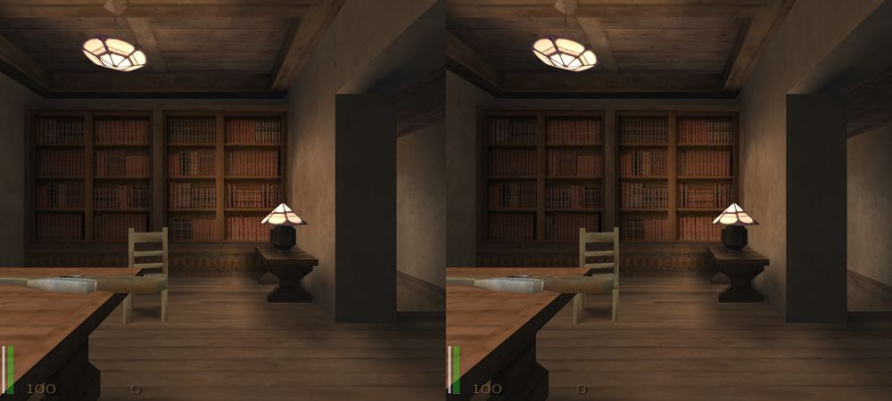
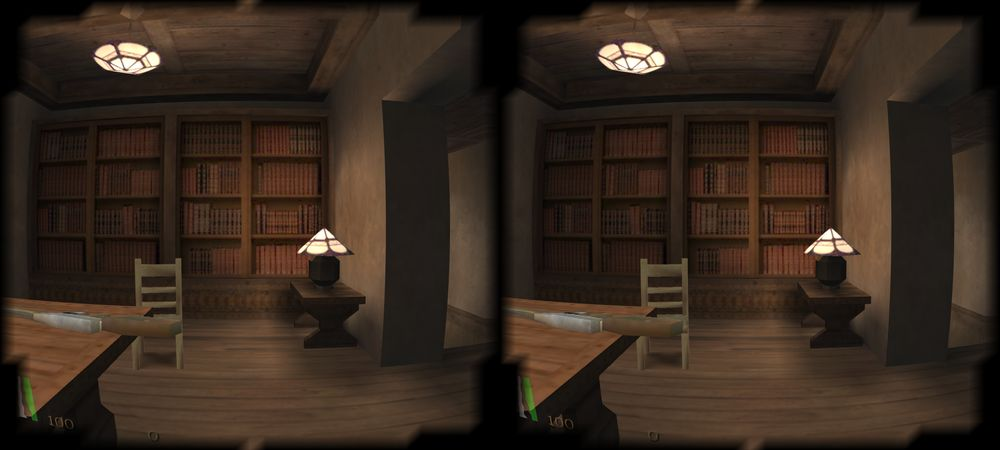
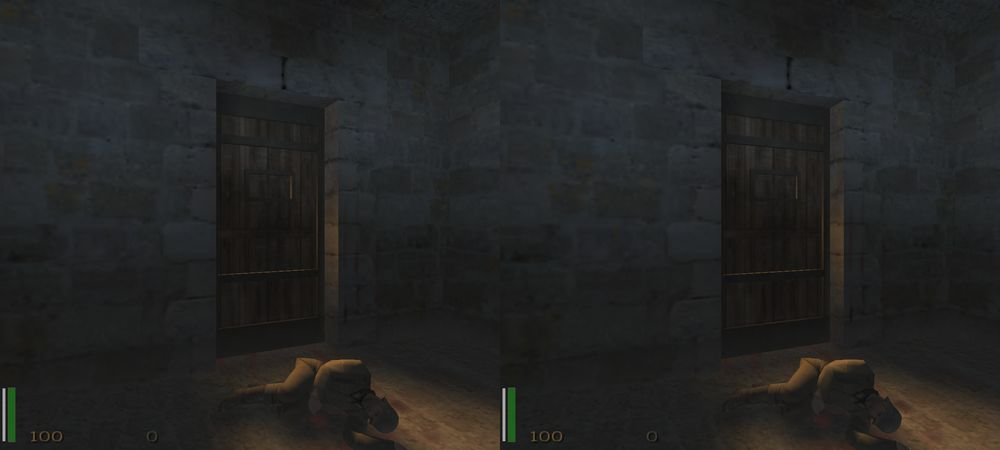
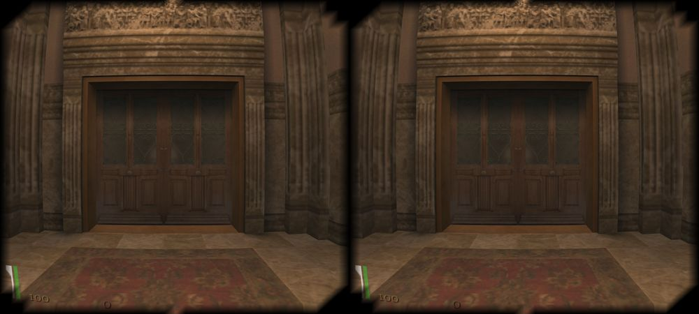

# 3DRTCW

Unofficial Android port of the [iortcw](https://github.com/iortcw/iortcw) engine (single player) with **stereoscopic 3D**
(side-by-side, half side-by-side, red/cyan anaglyph), **full gamepad support** (game and menus) and a live
**"3D Depth" slider** in the game menu. Sister project of [3DsBsQ3](https://github.com/Noneawe/3DsBsQ3).

> **Disclaimer.** This is an unofficial, fan-made port. It is not affiliated with, endorsed by or sponsored by
> id Software, Gray Matter, Activision or ZeniMax Media. All trademarks belong to their owners.
> The app and this repository contain **no game data**: you need your own legally obtained copy of the game
> (`pak0.pk3`, `sp_pak1.pk3` ... from the original installation, e.g. GOG or Steam).

| Side by Side (one full image per eye) | Side by Side with lens distortion (viewer) |
|---|---|
|  |  |

| Another scene | Milder lens strength (4) |
|---|---|
|  |  |

*Screenshots show game content (c) id Software / Gray Matter / Activision, taken on an emulator, and are included for
illustration only; they are not covered by the license of this repository.*

## Features

- Single player campaign from your own game data (the engine is the SP tree of iortcw; native `cgame` / `qagame` / `ui`
  modules are built as shared libraries because the original paks contain no QVMs).
- Stereo modes: **Off**, **Side by Side**, **SBS Half (squeezed)**, **Anaglyph (red/cyan)**. HUD and menus are drawn once
  per eye on the screen plane (no parallax); weapon models, scopes and cutscene cameras are handled per eye.
- **3D Depth** and **Convergence** sliders, live. **Render Scale** to keep the frame rate up when the scene is drawn twice.
- Phone-viewer options for SBS: **lens distortion** (strength slider), **image shift**, **image margin**.
- Gamepad for the game **and** the menus (Xbox / PlayStation / generic, USB or Bluetooth, hot-plug): LB/RB switch the
  menu tabs, A/B confirm/back, any pad button skips cutscenes, saving needs no keyboard (auto-named saves).
- Gamepad extras: **aim assist** (slows the stick near a visible enemy), one **zoom button** (LT: scope with sniper
  weapons, binoculars otherwise), in-game remapping screen (Options -> System -> Pad).
- Touch controls as an emergency fallback.
- Wide screens: HUD keeps 4:3 proportions, field of view adapts to the aspect ratio.

## Requirements

- Android 7.0 or newer (`minSdk 24`), **arm64** device, OpenGL ES 2.0, landscape.
- Your own game data (see below).
- For the stereo modes: a phone viewer (Cardboard style) for SBS, red/cyan glasses for anaglyph.

## Install

1. **Get the APK**: [`release/3DRTCW-0.1.apk`](release/3DRTCW-0.1.apk) in this repository, or
   [build it](#build-from-source). `adb install -r 3DRTCW-0.1.apk`, or copy it to the phone and open it.
   The release APK is signed with a debug key (fine for testing).
2. **Start the app once.** It creates the data folders and, while `pak0.pk3` is missing, shows a screen with the exact
   path (that launcher screen is currently in Polish).
3. **Copy the game data** (package id `io.github.noneawe.threedrtcw`) from the game's `Main` folder to
   `Android/data/io.github.noneawe.threedrtcw/files/main/`:
   `pak0.pk3`, `sp_pak1.pk3` ... `sp_pak4.pk3` (the `mp_pak*.pk3` files are not needed for single player).
   From a computer: `adb push pak0.pk3 /sdcard/Android/data/io.github.noneawe.threedrtcw/files/main/`
   (on Android 13+ file managers cannot open `Android/data`, use `adb`). Keep the file names lower case.
4. **Start the app again.** A damaged or cut-short `pak0.pk3` is detected and reported on that screen.

Our own `zz~stereo.pk3` (default pad bindings) and `zz~menus.pk3` (the 3D and Pad tabs) are created next to `pak0.pk3` on
every start. The menu pak is built **on the device from your own `ui/system.menu`**, so no game menu file is shipped.
No demo is supported: the demo is not known to work with this engine, see [docs/DECISIONS.md](docs/DECISIONS.md).

## Stereo modes

Open **Options -> System -> 3D** (main menu, or in game via Esc):

| Setting | What it does |
|---|---|
| **3D Depth** | Strength of the 3D effect (`r_stereoSeparation`, 0 - 2). Live. |
| **Stereo 3D** | `Off`, `Side by Side`, `Anaglyph`. Needs **Apply (restarts video)**. |
| **Convergence** | Distance of the zero-parallax plane (`r_stereoConvergence`, default 64). Live. |
| **Render Scale** | Resolution of the 3D rendering (`r_renderScale`). Needs Apply. |

Viewer cvars (console, or `startup.cfg`): `r_stereoLens 1`, `r_lensStrength 8` (0 - 20), `r_stereoShift 0.15`,
`r_stereoMargin`, `r_stereoHalf 1` (half SBS). Details: [docs/STEREO.md](docs/STEREO.md).

## Controls

**Gamepad** (defaults in `ui/pk3/pad_defaults.cfg`, remappable in Options -> System -> Pad):

| Pad | Action |
|---|---|
| Left stick / Right stick | move / look |
| RT / LT | fire / zoom (scope or binoculars) |
| A / B | jump / crouch |
| X / Y | reload / use |
| LB / RB | previous / next weapon |
| D-pad up / down | alternate fire / notebook |
| D-pad left / right | lean left / right |
| L3 / R3 | sprint / melee |
| Back / Start | objectives / menu |

**In menus:** D-pad or left stick moves, A selects, B or Start goes back, LB/RB switch tabs.
Full list and notes: [docs/INPUT.md](docs/INPUT.md). Touch: [docs/TOUCH.md](docs/TOUCH.md).

## Build from source

Requirements: JDK 17, Android SDK (platform 34), `ndk;28.2.13676358`, `cmake;3.22.1`, host CMake >= 3.25, a C compiler,
`git`, Python 3 with Pillow only if you regenerate the icon.

```
git clone <this repository>
cd <this repository>
scripts/setup.sh              # clones iortcw, gl4es and SDL2 at pinned commits and applies engine/patches/*
./gradlew assembleRelease     # app/app/build/outputs/apk/release/app-release.apk
```

More in [docs/BUILD.md](docs/BUILD.md).

## Known limits

- arm64 only; verified on the Android emulator and on one phone (Xiaomi, Adreno 810) with a Bluetooth pad.
- Several recent pad fixes (shooting, LB/RB tabs, cutscene skip, aim assist, LT zoom, leaving the Controls menu with B)
  were written after hands-on tests but are **not re-confirmed** on a device yet.
- Lens distortion uses a coarse 32x32 mesh: the black border of the lens image has visible stair-steps.
- No music: Ogg is not built yet. No multiplayer (SP tree only). Launcher screen text is Polish.
- Scoped weapons and cutscenes in SBS are only partly verified; action scenes were not captured yet.

## Documentation

[docs/BUILD.md](docs/BUILD.md) · [docs/STEREO.md](docs/STEREO.md) · [docs/INPUT.md](docs/INPUT.md) ·
[docs/TOUCH.md](docs/TOUCH.md) · [docs/DECISIONS.md](docs/DECISIONS.md)

## License

GNU GPL version 3 (see [LICENSE](LICENSE)). Third-party components are listed in [NOTICE](NOTICE): iortcw (GPLv3 /
GPLv2 parts), SDL2 (zlib), gl4es (MIT). Game data is not part of this repository and is not covered by the license.
